# EDIS: How the Enterprise Document Intelligence System Works

> **Living document.** It describes only code that exists in this repo today. When the code changes, update the matching section (see [§15](#15-current-status-and-keeping-this-doc-current)).
>
> **Last updated:** 2026-11-28 (matches branch `sync-project-01` at commit `3c0e3f6`)

**How to read this.** If you're new to these ideas, read §1 and §2, look at the diagrams, and use the [glossary](#16-glossary) as you go. If you're an experienced engineer, skip to §3 for the file map and §5–§9 for the details. Each section links to the code it describes.

## Contents

1. [Goal of the project](#1-goal-of-the-project)
2. [Architecture at a glance](#2-architecture-at-a-glance)
3. [Project map](#3-project-map)
4. [Life of a request](#4-life-of-a-request)
5. [Ingestion and indexing](#5-ingestion-and-indexing)
6. [Chat: routing and document answers](#6-chat-routing-and-document-answers)
7. [Document analysis](#7-document-analysis)
8. [Document comparison](#8-document-comparison)
9. [Custom instructions, human review and caching](#9-custom-instructions-human-review-and-caching)
10. [Accounts, sessions and storage](#10-accounts-sessions-and-storage)
11. [Configuration and model providers](#11-configuration-and-model-providers)
12. [Logging, tracing and error handling](#12-logging-tracing-and-error-handling)
13. [Tests and evaluation](#13-tests-and-evaluation)
14. [Running it](#14-running-it)
15. [Current status and keeping this doc current](#15-current-status-and-keeping-this-doc-current)
16. [Glossary](#16-glossary)

---

## 1. Goal of the project

EDIS lets you ask questions of business documents. You upload PDF, Word (`.docx`) or text files, or load the bundled dataset. Then you ask questions in plain English and get answers that cite the document and page each fact came from.

It does three jobs:

| Feature | You give it | You get back |
|---|---|---|
| **Chat with documents** | A question about the documents loaded into your session | An answer, plus the source passages the model actually cited (document, page, relevance score) |
| **Analyze a document** | One file, plus optional instructions | Title, summary, keywords, language and page count |
| **Compare two documents** | A reference file and an updated file, plus optional instructions | What changed, page by page or section by section |

Analysis and comparison results can be **approved or sent back with a note** (human review, §9), and repeated requests are served from a **cache** (§9).

The sample dataset in [`documents/`](../documents) holds four Indian financial and regulatory documents: the RBI KYC Directions, an IRDAI life insurance master circular, and the HDFC Life and LIC annual reports. These are the kind of long, dense documents a compliance or finance team has to answer questions about.

### The analogy: a research librarian

Think of EDIS as a research librarian in a private reading room.

| In the library | In EDIS | Technical term |
|---|---|---|
| You bring books into a private reading room | You start a session and load documents | Session, ingestion |
| The librarian cuts each book into index cards of about a paragraph | Text is split into ~1,600-character pieces | Chunking |
| Each card gets a "meaning fingerprint", so cards about similar ideas sit together even when they use different words | Each chunk becomes a list of numbers that captures its meaning | Embedding |
| The cards go into a catalogue sorted by meaning | Chunks and fingerprints are stored in ChromaDB | Vector database |
| You say something; the librarian first decides whether it needs the books at all | A model call classifies the message as general chat or a document question | Intent routing |
| For a book question, they fingerprint it and pull the 4 closest cards | Your question is embedded and the nearest chunks are fetched | Retrieval |
| They answer from only those cards and list which cards they used | The LLM returns an answer plus the IDs of the chunks that support it | Grounded generation |
| Writing a book report | Summary and metadata for one file | Analysis |
| Laying two editions side by side and noting changes | Page-by-page or section-by-section diff in plain English | Comparison |
| A supervisor signs off the report or sends it back | Approve or Request changes | Human-in-the-loop review |

Retrieval followed by generation is called **RAG (Retrieval-Augmented Generation)**. Its key benefit: the model answers from *your* documents rather than from memory, and can show its sources.

The librarian's "brain" is a large language model (LLM) from **OpenAI (default), Groq or Google**, chosen in configuration.

---

## 2. Architecture at a glance

EDIS is a single Python web server. It serves both the web pages and a JSON API, keeps its data on the local disk, and calls hosted AI services over the internet. The three AI features each run as a **LangGraph** workflow: a small graph of steps, some of which run in parallel.

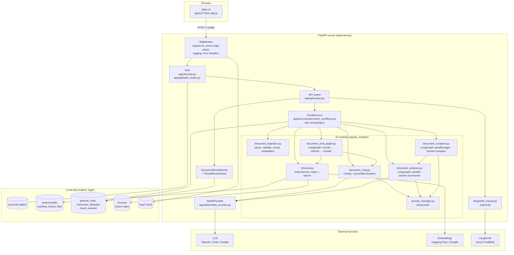

**Reading the diagram:**
- **Layers.** A request passes through middleware, then authentication, then a route, then `PortalService`, which calls the AI modules.
- **`PortalService` is the conductor.** It doesn't do AI work itself; it decides which module runs in what order, and holds the locks that keep stored files consistent.
- **Routes own caching and review records.** Before running analysis or comparison, the route asks the cache; after it, the route creates a review record.
- **Two kinds of AI calls.** *Embedding* calls (turning text into vectors) go to Hugging Face or Google. *Generation* calls (routing, answers, summaries, comparisons) go to the LLM.
- **Everything persistent is on local disk.** There's no separate database server; SQLite, ChromaDB and the JSON stores are all files. The result cache is in memory only.

---

## 3. Project map

```
proj-01-enterprise-document-intelligence-system/
├── app/
│   ├── main.py                    # Builds the FastAPI app: middleware, error handlers, page routes
│   ├── security.py                # Who is the caller? (auth modes) + 32-hex ID validation
│   ├── api/
│   │   ├── routes.py              # /api/* endpoints: sessions, upload, chat, analyze, compare, instructions, reviews
│   │   └── auth_routes.py         # /api/auth/*: signup, login, logout, session
│   ├── services/
│   │   ├── document_workflows.py  # PortalService: orchestrates every feature, saves chat history
│   │   ├── session_storage.py     # Session folders, general-chat history, instruction defaults, atomic JSON writes
│   │   ├── document_result_cache.py # In-memory TTL cache for analysis / compare results
│   │   ├── result_reviews.py      # Approve / Request-changes records per result
│   │   └── accounts.py            # SQLite accounts, password hashing, login tokens
│   ├── ai_module/
│   │   ├── document_ingestion.py  # File parsing, validation, chunking, embedding clients
│   │   ├── retrieval.py           # IndexService: ChromaDB indexing and similarity search
│   │   ├── document_chat.py       # Small-talk regex, intent router, query rewriting, cited answers
│   │   ├── document_chat_graph.py # LangGraph: rewrite → retrieve → (retry) → answer
│   │   ├── document_analysis.py   # LangGraph: parallel section summaries, then final JSON
│   │   ├── document_compare.py    # LangGraph: page alignment / document / section comparison
│   │   ├── prompt_manager.py      # Every LLM prompt in one place
│   │   ├── schemas.py             # Pydantic request/response shapes
│   │   └── evals.py               # Offline Document Chat benchmark (§13)
│   ├── config/config.py           # Settings dataclass: defaults, env vars, validation
│   ├── utils/
│   │   ├── model_provider.py      # Builds the chat model for the chosen provider
│   │   ├── custom_logger.py       # Structured JSON logging to console + file
│   │   ├── custom_exception.py    # DocumentIntelligenceError: safe diagnostics for logs
│   │   └── langsmith_tracing.py   # Opt-in LangSmith traces with hidden inputs/outputs
│   └── ui/                        # Static front end: index, workspace, account pages + JS/CSS
├── tests/                         # Pytest suite with mocked models (§13)
├── .github/workflows/ci.yml       # CI: flake8 + pytest on every push and pull request
├── documents/                     # Sample dataset used by "Load Dataset"
├── data_downloading_script/       # Document downloader + Streamlit front end
├── docs/ARCHITECTURE.md           # This file
├── requirements.txt
├── Dockerfile, .dockerignore      # Container build (not yet tested)
├── .env.example                   # Template for your .env
└── README.md
```

**Created at runtime (git-ignored):**

| Path | What's in it |
|---|---|
| `output/storage/accounts.sqlite3` | User accounts and login sessions |
| `output/storage/sessions/<session-id>/` | `manifest.json`, `history.json`, and the uploaded files (named by their SHA-256 hash) |
| `output/storage/chroma/` | The ChromaDB vector index (one collection per session) |
| `output/storage/general_chat/<owner-hash>.json` | General-chat history (no documents), last 40 turns per user |
| `output/storage/instruction_defaults/<owner-hash>.json` | Each user's saved default instructions for analysis and compare |
| `output/storage/result_reviews/<review-id>.json` | One review record per analysis or compare result |
| `output/<session-timestamp>/` | A JSON snapshot of each parsed document: pages, chunks and settings used (for inspection and debugging) |
| `logs/edis_*.jsonl` | Structured logs; the 10 newest files are kept |

`<owner-hash>` is the SHA-256 of the user's ID, so file names never contain usernames.

---

## 4. Life of a request

Every HTTP request follows the same path. Here's a chat question as the example:

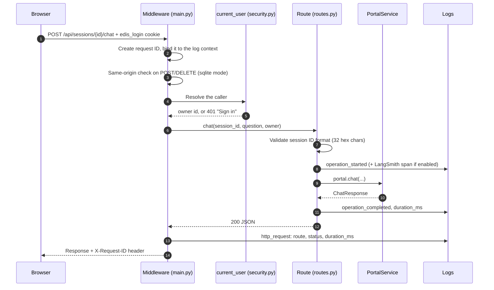

**What the middleware adds to every request** ([`main.py`](../app/main.py)):
- A **request ID** (12 hex characters) on every log line and in the `X-Request-ID` response header, so one request can be traced across the logs and LangSmith.
- A **same-origin check**: with built-in accounts enabled, a `POST` or `DELETE` whose `Origin` header doesn't match the server is rejected with 403. This blocks other websites from acting with your cookie (CSRF).
- **Safety headers**: `X-Content-Type-Options: nosniff` everywhere, `Cache-Control: no-store` on auth endpoints and on responses that contain user data.
- A **catch-all**: any unexpected error becomes a plain `500 Internal server error` with the request ID. Internal details go only to the logs (§12).

### API endpoints

| Method | Path | What it does |
|---|---|---|
| GET | `/api/health` | Liveness check |
| GET | `/api/dataset/session` | Find a saved session that already indexed the current dataset |
| POST | `/api/sessions` | Create an empty session |
| GET | `/api/sessions/{id}` | Session documents and chat history |
| DELETE | `/api/sessions/{id}` | Delete the session's files and vector index |
| POST | `/api/sessions/{id}/documents` | Upload 1–5 files and index them |
| POST | `/api/sessions/{id}/dataset` | Index the server's `documents/` folder |
| POST | `/api/sessions/{id}/chat` | Chat in a session: general reply or document answer (§6) |
| POST | `/api/chat` | General chat with no documents; a document question returns 409 |
| GET | `/api/chat/history/{conversation_id}` | Saved general-chat turns for one conversation |
| POST | `/api/analyze` | Analyze one file; form field `custom_instructions` optional. Returns `X-Review-ID` header |
| POST | `/api/compare` | Compare two files; form field `custom_instructions` optional. Returns `X-Review-ID` header |
| GET | `/api/instructions` | Your saved default instructions for `analysis` and `compare` |
| PUT | `/api/instructions/{workflow}` | Save (or clear, with an empty string) a default for one workflow |
| GET | `/api/reviews/{review_id}` | Read a result's review status and note |
| PUT | `/api/reviews/{review_id}` | Approve, or request changes (a note is required) |
| POST | `/api/auth/signup`, `/login`, `/logout` | Account management (form fields, sets a cookie) |
| GET | `/api/auth/session` | Is the browser signed in? |

Page routes: `/` (landing page), `/workspace` (redirects to `/login` if you're not signed in), `/login` and `/signup`. Interactive API docs are at `/docs`.

Upload, dataset, analyze and compare are `async` routes, and their slow work (parsing, embedding, LLM calls) runs in a **thread pool** (`run_in_threadpool`), so one long request doesn't freeze the server for everyone else. The chat routes are plain functions, which FastAPI also runs in its thread pool.

---

## 5. Ingestion and indexing

> **Analogy:** the librarian receives a box of books, checks each one is a real, readable book, cuts it into index cards, fingerprints every card, and files them in the catalogue.

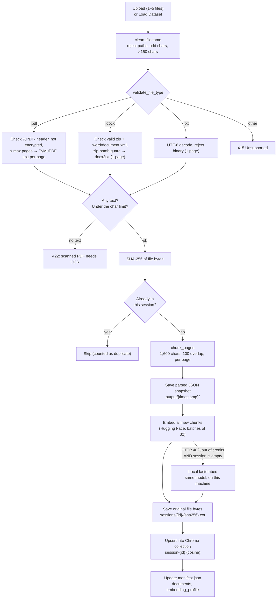

### Step by step

1. **Read safely** ([`read_upload_bytes`](../app/ai_module/document_ingestion.py)). It reads at most *limit + 1* bytes instead of trusting the browser's stated size, so an oversized upload is detected without loading it all into memory. It also checks the extension and that the file isn't empty, *before* any parsing. Analyze and compare keep these raw bytes, because the cache key (§9) is built from them.
2. **Parse** ([`parse_bytes`](../app/ai_module/document_ingestion.py)). PDFs keep their real page numbers. DOCX and TXT files have no pages, so they become a single "page 1". Each kind of bad file gets its own clear 422 message (bad PDF header, password-protected PDF, invalid DOCX, binary TXT, non-UTF-8 TXT). The raw parser error is never shown to the user.
3. **Guard rails.** Each limit protects the server:

   | Limit | Upload / compare | Analyze | Dataset |
   |---|---|---|---|
   | File size | 15 MB | 50 MB | 50 MB |
   | PDF pages | 100 | 1,000 | 1,000 |
   | Extracted characters | 500,000 | 5,000,000 | 5,000,000 |
   | Files | 5 per request | 1 | 100 total |

4. **Deduplicate.** Each file is identified by the SHA-256 hash of its bytes. Uploading the same file twice to one session skips it.
5. **Chunk** ([`chunk_pages`](../app/ai_module/document_ingestion.py)). The text is split into ~1,600-character pieces with 100 characters of overlap, so a sentence cut at a boundary still appears whole in one of the two neighbouring chunks. The splitter prefers to break at a space, and **chunks never cross a page**, which keeps citations accurate. Each chunk's ID is `<file hash>:<page>:<position>`.
6. **Embed.** Each chunk becomes a vector using `BAAI/bge-small-en-v1.5`. If the provider returns a different number of vectors than chunks, the upload fails with 502 rather than storing a mismatched index.
7. **Store.** Vectors, text and metadata (`document`, `page`, `sha256`) go into a ChromaDB collection named `session-<id>`, using cosine distance.

### The embedding fallback

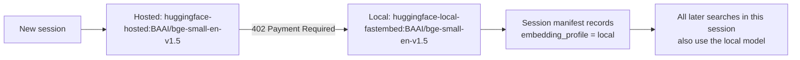

Normally embeddings come from the Hugging Face Inference API. If that returns **402 (out of credits)** while the session is still empty, EDIS switches to running the same model locally with `fastembed`. The first run downloads it, so it needs internet. The choice is saved as `embedding_profile` in the session manifest, because **a question must be embedded with the same model as the documents**, or the similarity scores are meaningless. For the same reason, changing the embedding model in config makes old sessions return 409 ("Load the documents in a new session").

### Loading the dataset, and reusing a saved index

Embedding four large reports is slow, so "Load Dataset" first checks whether you've already indexed the exact same files:

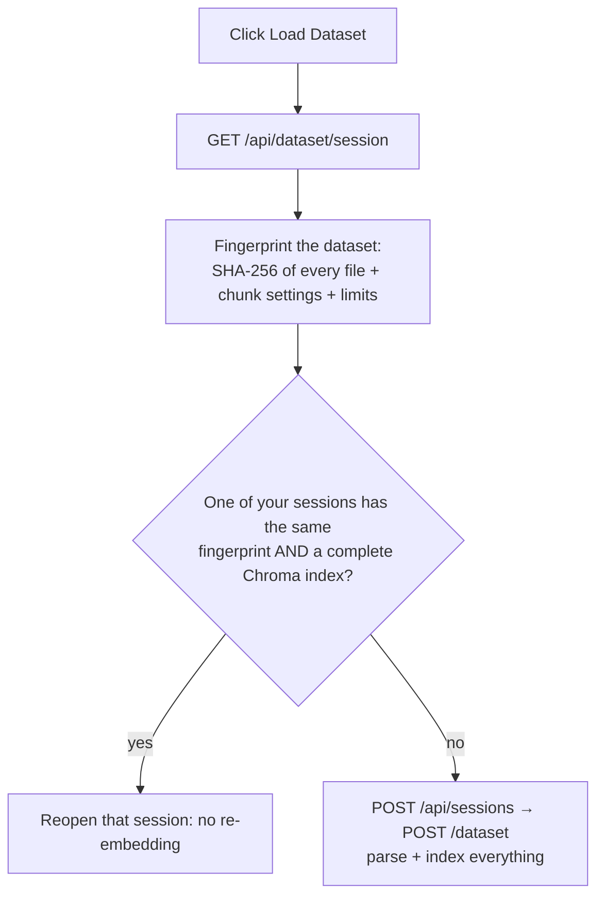

Changing any file in `documents/`, or `CHUNK_SIZE` / `CHUNK_OVERLAP`, changes the fingerprint and triggers a fresh index. Files that can't be read are skipped, listed in the response, and logged as `dataset_file_skipped`.

---

## 6. Chat: routing and document answers

> **Analogy:** you say something to the librarian. First they decide whether you need the books at all: "hello" or "what's the weather?" gets a direct reply. A real document question goes to the research desk, which works out what you're really asking, pulls the most relevant cards, and answers, handing back exactly which cards it used.

Chat happens in two stages: **routing** decides *whether* to search, then the **document chat graph** does the search and answer.

### Stage 1: routing ([`general_reply`](../app/ai_module/document_chat.py))

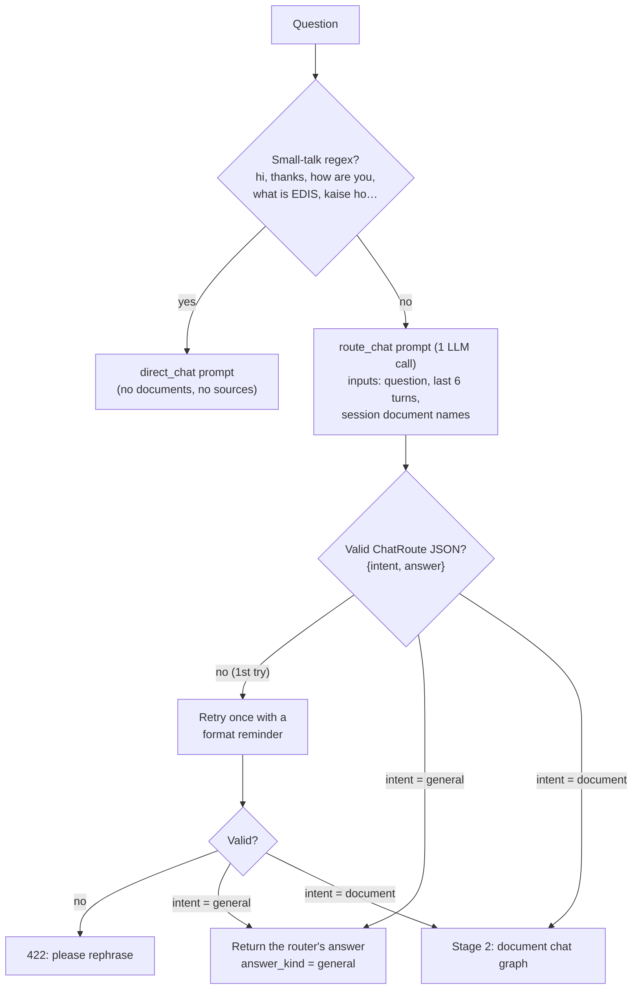

- The **regex** catches obvious small talk for free, with no model call. It now also handles greetings with an address ("hello sister", "hi bro"), repeated greetings and Hindi phrases.
- Anything else goes to the **intent router**, a single LLM call that returns strict JSON: `{"intent": "general", "answer": "..."}` or `{"intent": "document", "answer": null}`. The [`ChatRoute`](../app/ai_module/document_chat.py) Pydantic model rejects anything else, including a general intent without an answer. This handles typos ("hgello brother"), casual follow-ups and unrelated questions such as the weather without touching the vector index.
- **General chat** has no live tools, so the prompt tells it to say it can't check live information (weather, news) rather than guess.
- On `/api/chat` (no session), a document intent returns **409** "Use Load Dataset or Upload Documents before asking about files."

### Stage 2: the document chat graph ([`document_chat_graph.py`](../app/ai_module/document_chat_graph.py))

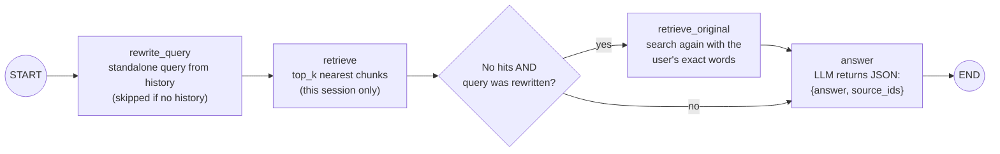

The graph runs while `PortalService` holds the storage lock, so it calls `IndexService.search_locked` (which doesn't take the lock again).

**How an answer is grounded and cited** ([`DocumentChatService.answer`](../app/ai_module/document_chat.py)):
1. Retrieved chunks are numbered 1, 2, 3… and sent to the model as a JSON list of `{id, document, page, text}`, capped at 20,000 characters in total.
2. The model must return `{"answer": "...", "source_ids": [1, 3]}`, or `{"answer": null, "source_ids": []}` if the excerpts don't support an answer. It's told to keep citations *out* of the answer text; the app builds them from the IDs.
3. The app checks the reply against [`GroundedReply`](../app/ai_module/document_chat.py). If the JSON is invalid, an ID is out of range, there are no IDs, or the answer is "I don't know…", the user gets the fixed reply **"I don't know based on the uploaded documents."** with **no sources**.
4. Only the **cited** chunks are returned as sources, one per (document, page), with a 350-character excerpt.

### Key design choices

| Choice | Why |
|---|---|
| **Regex first, then an LLM router** | The regex makes the common "hello" free. The router catches what a regex can't (typos, follow-ups, off-topic questions), so the vector search only runs when it's needed. |
| **Strict JSON with one retry** | The model's routing decision is validated before it's used. One retry with a format reminder fixes most bad outputs; after that the user is asked to rephrase rather than getting a guess. |
| **Query rewriting** (only when there's history) | "What about the penalty?" means nothing to a vector search on its own. The rewrite turns it into a full question first. |
| **Retry with the original question** | If the rewritten query finds nothing, the user's exact words get a second chance. |
| **Search with the rewritten query, answer the original** | Retrieval gets a precise query; the answer still responds to what the user actually typed. |
| **Sources come from `source_ids`, not from retrieval** | Retrieved-but-unused chunks are not shown, and the model can't invent a citation that wasn't in the request. |
| **Filter by `sha256 IN session documents`** | Only this session's documents can appear in results. |
| **Excerpts and history are labelled "untrusted data"** | Defends against *prompt injection*: a document containing "ignore your instructions and…" |
| **Last 12 history turns for answers; last 6 for routing** | Keeps prompts within model limits and cost predictable. |
| **No hits → fixed reply without calling the answer model** | Cheap, and nothing can be made up. |

### Chat memory

| Kind | Where it's saved | Scope |
|---|---|---|
| Session chat | `sessions/{id}/history.json`, last 40 turns | Per session; filtered by `conversation_id` |
| General chat (no session) | `general_chat/<owner-hash>.json`, last 40 turns | Per user; filtered by `conversation_id` |

Each turn is tagged with `answer_kind` (`general` or `document`). Only `document` turns are passed to the document graph as history, so small talk doesn't distort query rewriting. The browser keeps the current `conversation_id` in `sessionStorage`, so a refresh resumes the conversation; the **New Chat** button starts a fresh one. When old history is read back, small-talk turns saved by earlier versions are re-tagged as `general` and lose any sources.

The chat model can differ from the analysis model: `CHAT_LLM_PROVIDER` wins if set; otherwise chat uses `LLM_PROVIDER` (§11).

---

## 7. Document analysis

> **Analogy:** a book report. A short book is read in one sitting. For a 300-page annual report, three assistants each summarize different chapters at the same time, then the librarian combines their notes and writes the final report.

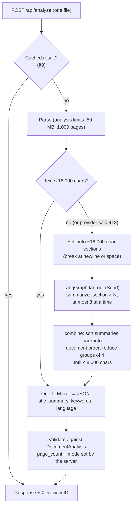

This **map-reduce** pattern lets an LLM with a limited context window handle very long documents. The map step now runs in **parallel** through a LangGraph graph ([`_build_segmented_analysis`](../app/ai_module/document_analysis.py)): `dispatch_sections` sends one `Send` per section to `summarize_section`, and `combine` waits for all of them. `max_concurrency = 3` (`DOCUMENT_WORKFLOW_CONCURRENCY`) limits how many model calls run at once, to stay inside provider rate limits. Each summary carries its section index, so the result is in document order even though sections finish in any order.

Other details, in [`document_analysis.py`](../app/ai_module/document_analysis.py):
- **Custom instructions** (§9) are applied to both the section summaries and the final analysis.
- **Groq "request too large" (413)** is handled by splitting the text in half and retrying, down to 512-character pieces.
- **Groq rate limits (429)** are retried up to 3 times, waiting as long as the provider's `retry-after` header asks (up to 60 s). After that the user gets a clear 429 message.
- **With Groq**, analysis output is capped at 1,024 tokens.
- **Facts the server already knows aren't trusted to the model.** `page_count` and `mode` are overwritten with real values, and output that doesn't match the schema becomes a 502 "invalid response".

---

## 8. Document comparison

> **Analogy:** a proofreader with two drafts. For two PDFs, they first line up matching pages, even if pages were inserted or removed, and then check the pairs in parallel. For other files or very long ones, they summarize both documents side by side, then compare the summaries.

The whole comparison is one LangGraph graph ([`DocumentCompareService._build_graph`](../app/ai_module/document_compare.py)):

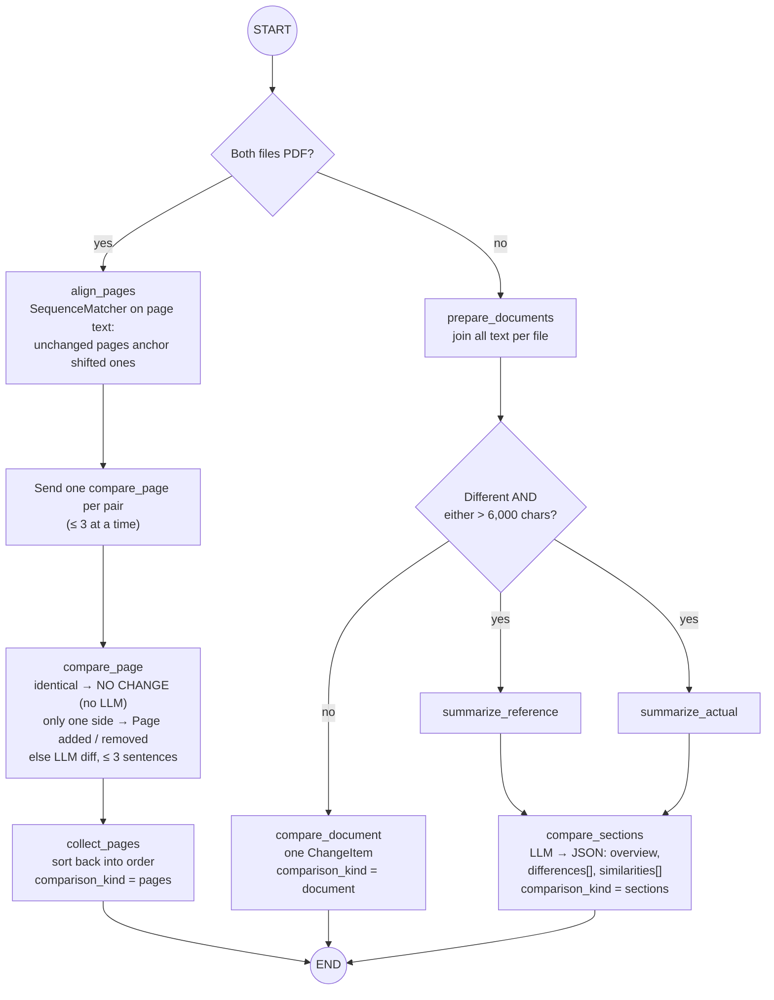

**Page alignment is new.** Previously page 5 was always compared with page 5, so inserting one page made every later page look "changed". Now [`_align_pages`](../app/ai_module/document_compare.py) uses Python's `difflib.SequenceMatcher` on the normalized text of each page. Identical pages act as anchors; pages between anchors are paired in order, and a page with no partner is reported as **Page added** or **Page removed**. Each `ChangeItem` records both `reference_page` and `actual_page`.

Other details:
- For a page pair where either side is over 6,000 characters, that side is summarized first.
- In the sections path, the two documents are summarized **in parallel** (two graph branches), in 12,000-character sections reduced to a ≤ 4,000-character overview.
- The section prompt says the two files *may cover different subjects*, so the model doesn't assume the second is a revision of the first.
- Custom instructions (§9) are passed to every comparison prompt.
- Comparison reuses the analysis service's model, section splitting and retry helpers.

The three result shapes, all in [`CompareResponse`](../app/ai_module/schemas.py):

| `comparison_kind` | When | `changes` holds | Extra fields |
|---|---|---|---|
| `pages` | Both files are PDFs | One `ChangeItem` per aligned page pair: `changed`, `summary`, `reference_page`, `actual_page` | none |
| `document` | Not both PDFs, and short or identical | One `ChangeItem` for the whole file | none |
| `sections` | Not both PDFs, and long | empty | `overview` (overview, differences, similarities), `reference_sections`, `actual_sections` |

---

## 9. Custom instructions, human review and caching

These three features wrap the analysis and compare workflows. They live in the route handlers in [`routes.py`](../app/api/routes.py).

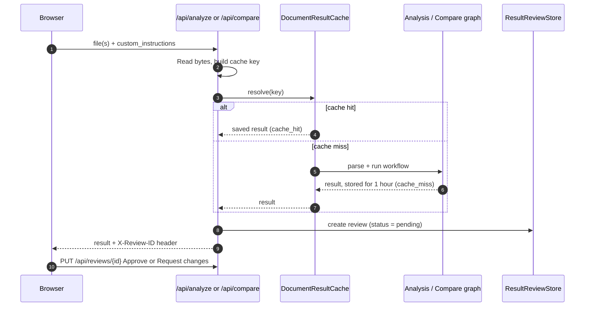

### Custom instructions

- A free-text field (up to 1,200 characters) in Analysis & Summary and Compare: for example "answer in Hindi" or "focus on penalties".
- **How they reach the model** ([`document_prompt`](../app/ai_module/prompt_manager.py)): the instructions go in a *separate* message from the document text, and the system prompt is extended to say they apply **only when compatible with the rules**. Evidence rules, output format and source constraints always win, so instructions can change tone, language or focus but can't switch off grounding.
- **Save as my default** stores them per user and per workflow in `instruction_defaults/<owner-hash>.json` (`PUT /api/instructions/{workflow}`); the UI prefills the field from `GET /api/instructions`. Saving an empty string clears the default.

### Human review

- Every analysis or compare response gets a new review record (`status = pending`) and its ID in the `X-Review-ID` header. The CORS config exposes that header to the browser.
- `PUT /api/reviews/{id}` sets `approved` or `changes_requested`. A note is **required** for `changes_requested` ([`ReviewDecision`](../app/ai_module/schemas.py)).
- Records are owned: another user's review ID returns 404, the same as a missing one. The ID must be 32 hex characters.
- A **new review is created even on a cache hit**, so each result a user sees is reviewed on its own.

### Result cache ([`document_result_cache.py`](../app/services/document_result_cache.py))

| Property | Value |
|---|---|
| Store | `cachetools.TTLCache`, in process memory |
| Size / lifetime | 100 entries in total, each kept up to 1 hour |
| Key | user, cache version, LLM provider and model IDs, size/page/character limits, each file's name (analysis) or extension (compare) plus SHA-256 of its bytes, SHA-256 of the instructions |
| What's stored | The validated response as JSON; only successful results |
| Concurrency | A `Condition` lock, so two identical requests at once don't both run the workflow |

Because the key includes the user, provider, model and instructions, changing any of them produces a new entry rather than a wrong answer. A hit skips parsing and every model call. The cache is lost on restart and isn't shared between server processes. Look for `cache_hit` / `cache_miss` in the logs.

---

## 10. Accounts, sessions and storage

### Who are you? Three auth modes

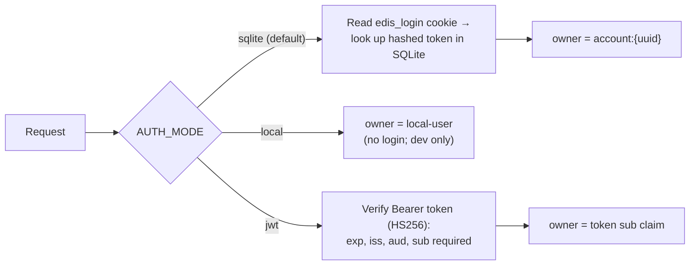

`APP_ENV=production` refuses to start unless `AUTH_MODE=jwt`.

### Built-in accounts (`sqlite` mode), in [`accounts.py`](../app/services/accounts.py)

| Aspect | Implementation |
|---|---|
| Username | 3–32 characters: `a-z 0-9 _ -`, lower-cased |
| Password | 15–128 characters |
| Password storage | `scrypt` (n=2¹⁵, r=8, p=3) with a random 16-byte salt per user. A slow-by-design hash, so stolen hashes are hard to crack. |
| Login timing | If the username doesn't exist, it still hashes against a dummy value, so response time doesn't reveal which usernames exist |
| Login token | 32 random bytes; **only its SHA-256 hash is stored**, so a leaked database can't be used to log in |
| Cookie | `edis_login`: `HttpOnly` (JavaScript can't read it), `SameSite=Strict`, `Secure` over HTTPS, 8-hour lifetime |
| Cleanup | Expired login sessions are deleted at each new login; logging in replaces your previous token |

The account database is created when the app starts. If that fails, the app logs `account_storage_startup_failed` and doesn't start.

### Sessions: your private reading room

A **session** is a workspace with its own documents, vector index and chat history. The `owner` is stamped on it at creation.

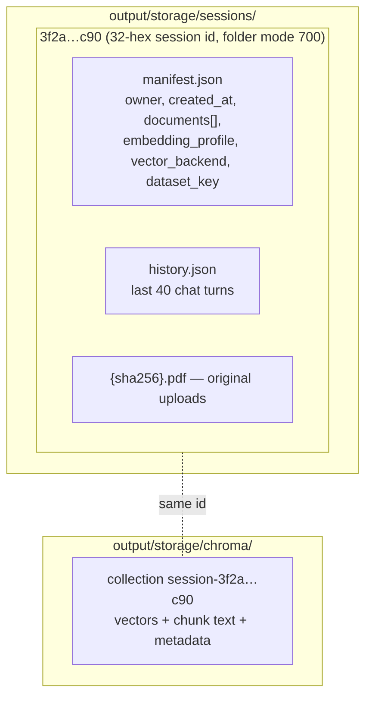

Safety rules in [`session_storage.py`](../app/services/session_storage.py) and [`security.py`](../app/security.py):
- **Session, conversation and review IDs must be exactly 32 hex characters**, which makes path tricks like `../../etc` impossible.
- **Ownership is checked before any work**, and before an upload's bytes are even processed. Someone else's session or review returns **404, not 403**, so attackers can't tell which IDs exist.
- **Atomic writes.** JSON is written to a temporary file, flushed to disk, then renamed over the original, so a crash never leaves a half-written file.
- **Separate locks** (`threading.RLock` / `Lock`) for session files, general-chat history, instruction defaults and reviews. Everything is intentionally **single-server**; running several replicas would need object storage, a real database and a shared cache.
- **Deleting a session** removes its Chroma collection and its folder.

### What the browser keeps

The UI stores the current session ID and the current `conversation_id` in `sessionStorage` (cleared when the tab closes), so a page refresh can reopen both. The login cookie isn't readable by JavaScript.

---

## 11. Configuration and model providers

All settings live in one frozen dataclass, [`Settings`](../app/config/config.py). Values come from environment variables (or `.env`, loaded by `python-dotenv`) and are **validated at startup**, so a bad configuration fails immediately with a clear message instead of failing mid-request. Blank values (for example `LLM_PROVIDER=` in `.env`) fall back to the default, and API keys and model IDs are trimmed of stray whitespace.

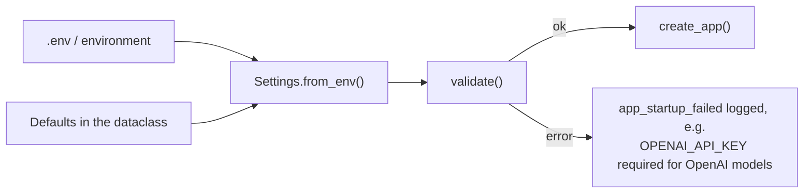

### Main settings

| Env var | Default | Meaning |
|---|---|---|
| `LLM_PROVIDER` | `openai` | Model for analysis, comparison and (by default) chat: `openai`, `groq` or `google` |
| `CHAT_LLM_PROVIDER` | *(unset)* | Overrides the provider for chat only; unset means chat uses `LLM_PROVIDER` |
| `OPENAI_CHAT_MODEL` / `GROQ_CHAT_MODEL` / `GOOGLE_CHAT_MODEL` | see table below | Model ID for each provider |
| `EMBEDDING_PROVIDER` | `huggingface` | `huggingface` or `google` |
| `VECTOR_BACKEND` | `chroma` | Only `chroma` is supported |
| `AUTH_MODE` | `sqlite` | `sqlite`, `local` or `jwt` |
| `APP_ENV` | `development` | `development`, `test` or `production` |
| `CHUNK_SIZE` / `CHUNK_OVERLAP` | 1600 / 100 | Characters per chunk / overlap |
| `OUTPUT_DIR` / `STORAGE_DIR` / `DATASET_DIR` | `output/`, `output/storage`, `documents/` | Where data lives |
| `CORS_ORIGINS` | `http://localhost:8080,http://127.0.0.1:8080` | Browser origins allowed to call the API |
| `LANGSMITH_TRACING` / `LANGSMITH_API_KEY` / `LANGSMITH_PROJECT` | off / none / none | Optional tracing (§12); all three are needed to turn it on |
| API keys | (none) | `OPENAI_API_KEY`, `GROQ_API_KEY`, `GOOGLE_API_KEY`, `HF_TOKEN` (or `HUGGINGFACEHUB_API_TOKEN`) |

Only the key for the selected provider is required: with the default settings you need `OPENAI_API_KEY` and `HF_TOKEN`. The app never silently switches to another provider because a different key happens to be set. The upload, analysis and dataset limits in §5 are also configurable (`MAX_UPLOAD_MB`, `MAX_PAGES`, …).

### Models, in [`model_provider.py`](../app/utils/model_provider.py)

| Provider | Default model | Notes |
|---|---|---|
| OpenAI | `gpt-4.1-mini` | 30 s timeout, no automatic retries |
| Groq | `qwen/qwen3.8-27b` | On a rate limit, automatically falls back to `openai/gpt-oss-120b`, then `openai/gpt-oss-20b` |
| Google | `gemini-3.5-flash-lite` | Temperature 0 |
| Embeddings (HF) | `BAAI/bge-small-en-v1.5` | Hosted API, 60 s timeout, batches of 32; local `fastembed` fallback (§5) |
| Embeddings (Google) | `models/gemini-embedding-001` | |

Models are created **lazily**: nothing connects to a provider until the first request needs it, which keeps startup fast. All calls go through **LangChain** (`prompt | model | parser` chains), and the multi-step features are **LangGraph** graphs on top of those chains, so switching providers changes no feature code.

**Prompts** all live in [`prompt_manager.py`](../app/ai_module/prompt_manager.py). Every prompt that receives document text tells the model to treat that text as untrusted data, not instructions.

---

## 12. Logging, tracing and error handling

### Logs

[`custom_logger.py`](../app/utils/custom_logger.py) uses **structlog** to write one JSON object per line, to both the console and `logs/edis_<DDMM_HHMMSS>.jsonl`. Only the 10 newest log files are kept. Most events now carry a plain-English `message` that explains what happened.

```json
{"request_id": "a1b2c3d4e5f6", "event": "operation_completed", "message": "Document chat finished successfully.", "operation": "document_chat", "duration_ms": 2140.5, "level": "info", "logger": "EDIS", "timestamp": "2026-11-28T12:54:08Z"}
```

Events you'll see:

| Event | Emitted by |
|---|---|
| `app_started` / `app_stopped` / `app_startup_failed` | App lifespan: shows which providers are active, or why startup failed |
| `http_request` | Every request: method, route, status, duration |
| `operation_started` / `_completed` / `_failed` | Upload, dataset, chat, analyze, compare |
| `request_validation_failed` | A 422 from bad request data: which fields, and the kind of problem (never the values) |
| `dataset_files_found`, `dataset_file_skipped` | Dataset loading |
| `document_embedding_started`, `using_local_huggingface_embeddings`, `document_index_write_started`, `document_index_ready`, `document_index_no_changes` | Indexing |
| `document_chat_rewrite`, `document_chat_search`, `document_chat_search_retry`, `document_chat_answer`, `chat_guardrail` | Chat graph steps and rejected model outputs |
| `document_analysis_direct` / `_segmented` / `_section_completed` / `_combining`, `pdf_pages_aligned`, `pdf_pages_compared`, `document_compare_*` | Analysis and comparison progress |
| `cache_hit` / `cache_miss`, `result_review_saved` | §9 |
| `model_provider_rate_limit`, `model_provider_connection_error`, `model_provider_request_failed`, `embedding_provider_error`, `storage_operation_failed`, `unhandled_request_error` | Failures |

Logs record **metadata only** (status codes, counts, durations, error types and code locations), never document text, questions, custom instructions or API keys.

### Error diagnostics

Every failure is logged through `log_failure` in [`main.py`](../app/main.py), which wraps the error in [`DocumentIntelligenceError`](../app/utils/custom_exception.py). Its `log_fields()` adds the error type, the file and line where it was raised (`source`) and the traceback frames (file, line, function), without the exception's message text, which could contain user data. Unexpected errors are sorted into provider failures (Groq, OpenAI or Google status errors, with the upstream HTTP status), storage failures (with the OS reason, such as "No space left on device") and everything else.

### LangSmith tracing (optional)

[`langsmith_tracing.py`](../app/utils/langsmith_tracing.py) wraps each operation (chat, analysis, compare, upload, dataset) and each cache hit or miss in a LangSmith trace, but **only** when `LANGSMITH_TRACING=true`, `LANGSMITH_API_KEY` and `LANGSMITH_PROJECT` are all set. Otherwise tracing is explicitly disabled, including for the LangChain calls inside.

When enabled, the trace client is configured for privacy: **inputs and outputs are hidden**, only `request_id` and model metadata (`ls_provider`, `ls_model_name`, `ls_model_type`) are kept, and error text is replaced with "See the correlated application logs." Match a trace to the logs with its `request_id`.

### Error handling

Provider errors are turned into clear, safe HTTP responses in [`main.py`](../app/main.py):

| Problem | HTTP status | Message to the user |
|---|---|---|
| Provider rate limit (Groq/OpenAI) | 429 | "rate limit reached, try again in N seconds" (or "quota exhausted") |
| Provider unreachable / timed out | 502 / 504 | "could not reach…" / "did not respond in time" |
| Wrong OpenAI key | 502 | "Check OPENAI_API_KEY" |
| LLM returned malformed JSON (analysis/compare) | 502 | "The AI returned an invalid response" |
| Router output invalid twice (chat) | 422 | "I couldn't tell whether your question was about the documents. Please rephrase it." |
| Document answer invalid or uncited (chat) | 200 | "I don't know based on the uploaded documents." with no sources |
| Hugging Face out of credits | 503 (or local fallback) | see §5 |
| Bad file | 400 / 413 / 415 / 422 | Specific reason (too large, wrong type, bad PDF header, no text…) |
| Bad request data | 422 | FastAPI's field-level validation message |
| Anything unexpected | 500 | "Internal server error" + request ID (details only in the logs) |

---

## 13. Tests and evaluation

### Automated tests ([`tests/`](../tests))

The suite uses `pytest` with **mocked model responses**, so it needs no API keys and makes no network calls.

| File | What it checks |
|---|---|
| `test_document_chat_graph.py` | Rewrite-retry, routing of greetings/typos/weather without RAG, the one-retry router guardrail, only valid `source_ids` returned, unsupported answers have no sources, general-chat memory survives a restart and is per user, document and general conversations stay separate |
| `test_document_analysis_compare_graphs.py` | Custom instructions reach the model and get separate cache entries, per-user instruction defaults, reviews are owned and independent of cached results, shifted PDF pages align with additions/removals, long analysis splits and merges in order, short vs long text comparison modes |
| `test_model_provider_config.py` | OpenAI is the default even when other keys exist, a missing key fails instead of falling back, per-provider model IDs, the chat-only override |
| `test_request_logging.py` | Console progress messages and structured failure details, with sensitive values kept out of the logs |

**CI** ([`.github/workflows/ci.yml`](../.github/workflows/ci.yml)) runs on every push and pull request with Python 3.12: `flake8 --select E9,F` (syntax errors and Pyflakes findings such as undefined names), then `pytest -q tests`. It sets `PYTHON_DOTENV_DISABLED=1` and turns LangSmith off, so no local `.env` or keys are involved.

### Offline chat evaluation ([`evals.py`](../app/ai_module/evals.py))

`python -m app.ai_module.evals` is a small benchmark that uses the **real** chat and embedding providers from your `.env`, so it costs API credits. It builds a synthetic two-page "travel handbook" PDF, indexes it into a temporary Chroma store, and runs seven cases:

| Case | Expected |
|---|---|
| `expense_deadline_citation` | Grounded answer mentioning 45 days, citing page 2 |
| `greeting_with_document_question` | Grounded answer ("economy"), citing page 1, despite the "Hello bro" |
| `missing_evidence` | "I don't know…" with no sources |
| `greeting_with_address`, `greeting_with_typo`, `small_talk_followup`, `unrelated_weather_question` | General replies with **no vector search** |

It checks the answer, the cited page and the number of searches for each turn, prints a JSON report, and disables LangSmith tracing while it runs. Exit code `0` = all passed, `1` = at least one failed, `2` = setup failed.

---

## 14. Running it

**Locally** (Python 3.12):

```bash
python3.12 -m venv env && source env/bin/activate
pip install -r requirements.txt
cp .env.example .env            # add OPENAI_API_KEY and HF_TOKEN at minimum
uvicorn app.main:app --reload --port 8080
```

Open <http://localhost:8080>, sign up, then click **Load Dataset** or upload files.

**Tests:**

```bash
export PYTHON_DOTENV_DISABLED=1 LANGSMITH_TRACING=false LANGSMITH_TRACING_V2=false
python -m flake8 --select E9,F app data_downloading_script tests
python -m pytest -q tests
```

**With Docker** (Dockerfile written but **not yet tested**):

```bash
docker build -t edis .
docker run --rm -p 8080:8080 -v "$PWD/.env:/app/.env:ro" -v edis-data:/app/output edis
```

The image installs `libgomp1` (needed by fastembed's ONNX runtime on slim images), runs as a non-root user, excludes `.env` and runtime data (see `.dockerignore`), and has a health check on `/api/health`.

**Document downloader** (separate from the app): `cd data_downloading_script && streamlit run streamlit_app.py`. Files go to `data_downloading_script/downloads/`.

---

## 15. Current status and keeping this doc current

### Status as of 2026-11-28

| Area | Status |
|---|---|
| Chat (routing + RAG), analysis, comparison, accounts, sessions, dataset indexing | Implemented, as LangGraph workflows |
| Custom instructions, human review, result caching, chat memory | Implemented |
| Structured logs, error diagnostics, optional LangSmith tracing | Implemented |
| Automated tests and CI | 31 tests passing locally; CI runs on GitHub |
| Offline chat evaluation | Implemented (seven cases) |
| Docker | Written, not yet built or tested |
| Cloud deployment (AWS ECS) | Not started |
| MCP client/server, LLM gateway | Not started; the app calls providers directly |
| Scale | Single server only (local files, in-process locks and cache) |

### How to update this document

When you change code, update the matching section:

| If you change… | Update |
|---|---|
| A route or endpoint | §4 endpoint table |
| Parsing, limits, chunking, embeddings | §5 |
| `document_chat.py`, `document_chat_graph.py` or chat logic in `document_workflows.py` | §6 |
| `document_analysis.py` | §7 |
| `document_compare.py` or `schemas.py` | §8 |
| Instructions, reviews or the result cache | §9 |
| Auth, accounts, session storage | §10 |
| `config.py` or `model_provider.py` | §11 |
| Logging, tracing or exception handlers | §12 |
| Tests, CI or `evals.py` | §13 |
| A new file or folder | §3 project map, and §2 if it's a new component |

Then bump **Last updated** at the top. Diagrams are Mermaid code blocks; GitHub renders them, and in VS Code you can preview them with a Mermaid extension.

---

## 16. Glossary

| Term | Plain-English meaning |
|---|---|
| **API** | A set of URLs a program can call to get or send data, here returning JSON |
| **FastAPI** | The Python web framework EDIS is built on |
| **LLM** | Large language model: the AI that reads text and writes answers (GPT, Gemini, Qwen…) |
| **Embedding** | A list of numbers representing the *meaning* of a piece of text. Similar meanings give nearby numbers. |
| **Vector database** | A database that finds the stored embeddings closest to a given one. EDIS uses ChromaDB. |
| **Cosine distance** | A measure of how different two embeddings' directions are. EDIS shows `score = 1 − distance`, so higher means more relevant. |
| **Chunk** | A ~1,600-character piece of a document, the unit that gets embedded and retrieved |
| **RAG** | Retrieval-Augmented Generation: fetch relevant chunks first, then have the LLM answer from them |
| **Intent routing** | Deciding whether a message needs the documents at all before searching |
| **Grounding** | Making the model answer only from supplied evidence, and say so when the evidence isn't there |
| **Guardrail** | A check on the model's output (valid JSON, valid citation IDs) that replaces a bad output with a safe one |
| **Prompt** | The instructions and context sent to the LLM |
| **Prompt injection** | Text inside a document that tries to give the LLM new instructions. EDIS's prompts tell the model to ignore such text. |
| **Map-reduce** | Summarize pieces separately (map), then combine the summaries (reduce) |
| **LangChain** | A library that gives one interface to many LLM providers and chains prompts, models and output parsers together |
| **LangGraph** | A library for building workflows as graphs of steps with shared state, branches and parallel fan-out |
| **`Send` (fan-out)** | A LangGraph instruction to run the same step once per item, in parallel |
| **LangSmith** | A hosted service for viewing traces of LLM calls |
| **Trace** | A record of one request's steps and timings |
| **TTL cache** | A cache whose entries expire after a fixed time (here, one hour) |
| **Human-in-the-loop (HITL)** | A person approves or rejects the AI's output |
| **Session** | Your private workspace in EDIS: its documents, index and chat history |
| **SHA-256 hash** | A fingerprint of a file's exact bytes; identical files always have the same hash |
| **Manifest** | `manifest.json`, the record of what a session contains |
| **JWT** | JSON Web Token: a signed token proving who you are, used in `jwt` auth mode |
| **scrypt** | A deliberately slow password-hashing algorithm that makes stolen hashes hard to crack |
| **CSRF** | Cross-site request forgery: another website tricking your browser into acting for you. Blocked by the same-origin check and `SameSite` cookies. |
| **CI** | Continuous integration: automatically running checks and tests on every push |
| **Pydantic** | A library that validates data against a defined shape (the schemas in `schemas.py`) |
| **structlog** | A library for structured (JSON) logging |
| **Thread pool** | Background workers that run slow tasks so the server stays responsive |
